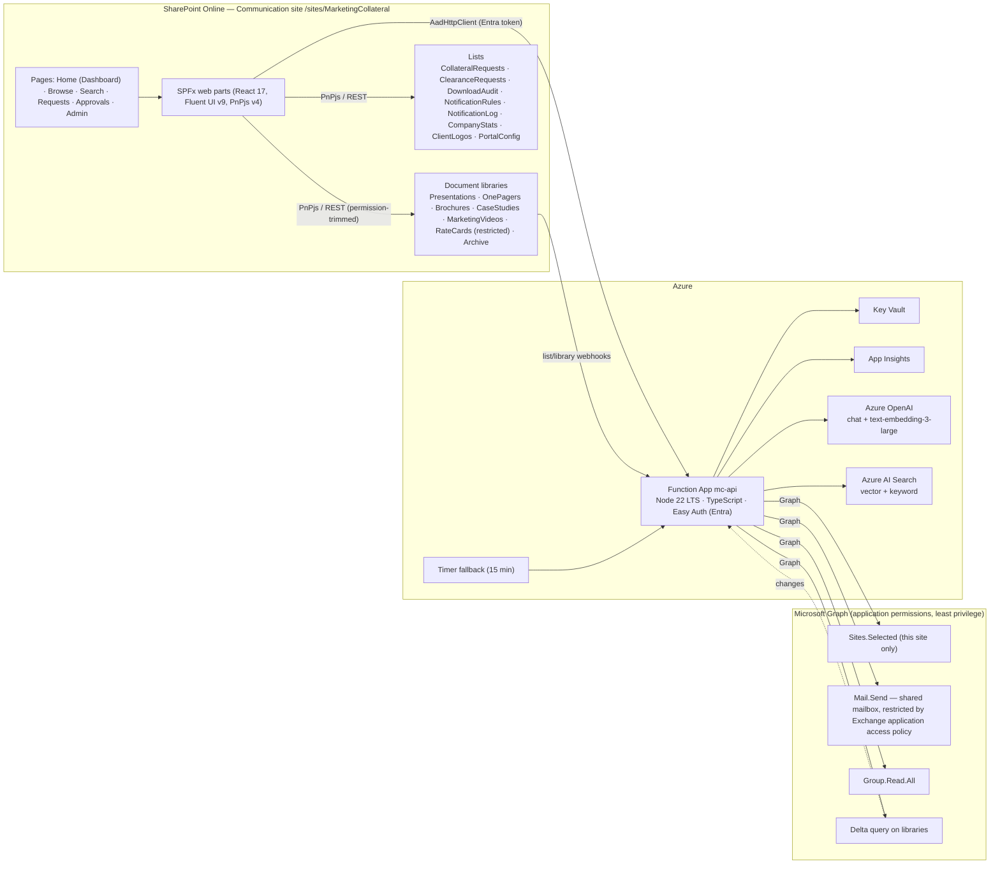

# Architecture — MarketingCollateral

Written for: engineers joining the project and the Academian stakeholders who sign off on design.
Decisions are recorded as ADRs in [adr/](adr/README.md). This page shows the shape of the system.

## 1. Diagram

## 2. Components

| Component | Responsibility | Tech | Phase |
|---|---|---|---|
| SPFx web parts (`spfx/`) | UI: dashboard, browse, search, upload, requests, approvals, admin | SPFx 1.23 (GA line, React 17), Fluent UI v9, PnPjs v4, strict TS | 4+ |
| `mc-api` (`api/`) | Download/share broker, clearance, notifications and digest, request lifecycle, audit, AI endpoints | Azure Functions, Node 22 LTS, TypeScript | 5+ |
| Provisioning (`provisioning/`) | Idempotent site, term sets, content type, libraries, lists, groups, search schema, seed data | PnP.PowerShell + PnP template | 2 |
| Migration (`migration/`) | Excel → list items and file copy, dry-run by default | Node/TS or Python (decided in Phase 3) | 3 |
| Config (`config/environments/`) | Tenant and environment values. No secrets | JSON | 1 |
| Shared models (`shared/`) | Typed models used by SPFx and API | TypeScript package | 2+ |
| Scripts (`scripts/`) | Local helpers, workbook profiler | Python 3 (openpyxl) | 1 |

## 3. Key flows

**Download (Notify mode)** — Sales user → `POST /collateral/{id}/download` → permission check → ClearanceMode = Notify → stream file, write `DownloadAudit`, evaluate `NotificationRules`, email approver.

**Download (Approve mode)** — same entry point → create `ClearanceRequests` row → email approver with deep link to Approvals → respond `pending`. Approval grants item-level read until `AccessExpiresAt`. A timer job revokes it.

**Publish notification** — library change → webhook → Function → Graph delta → if Status moved to Published, or item moved to Archive or deleted → queue → immediate send or digest per rule → `NotificationLog`.

**Stat change** — `CompanyStats` edit (Admin) → AI stats check across collateral → `StatsReviewRequired` set → owners emailed → dashboard "Needs review" count.

## 4. Data and permissions

- System of record: libraries (files, versions) and lists (metadata, requests, audit). Personal OneDrive is not used.
- Versioning: native major and minor versions, check-in/out on RateCards only (ADR-0003).
- Restricted items (RateCards and any `Sensitivity = Restricted`) have broken inheritance. Visitors never open them directly. All access goes through `mc-api` (ADR-0004).
- Roles and groups: see brief §5. Names are config values in `config/environments/`.

## 5. Non-functional

- Security: least-privilege Graph (`Sites.Selected`), secrets in Key Vault via managed identity, input validation on every endpoint. See [security.md](security.md).
- Accessibility: WCAG 2.2 AA, axe-core checks in tests.
- Performance: dashboard first render < 2 s on dev; counts cached 5 min; batched PnPjs calls.
- Observability: App Insights with correlation IDs from SPFx to API; alert on failed notifications.
- AI: behind a feature flag (`aiEnabled`). When off, every non-AI path must still work (ADR-0007).

## 6. Open architecture questions

- Node 22 vs 20 — resolved in ADR-0002, pending confirmation.
- SPFx line: 1.23 (React 17) now, 1.24 (React 18) when GA. ADR-0001.
- Migration tooling language (Node or Python). Decided in Phase 3.
- Teams tab (Phase 7, optional).
